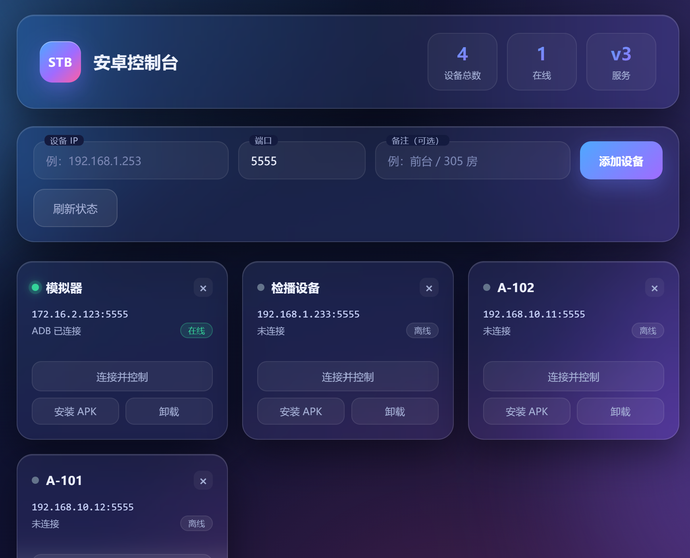
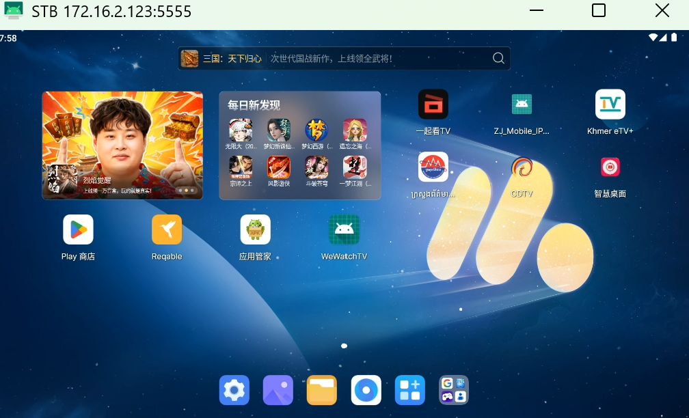
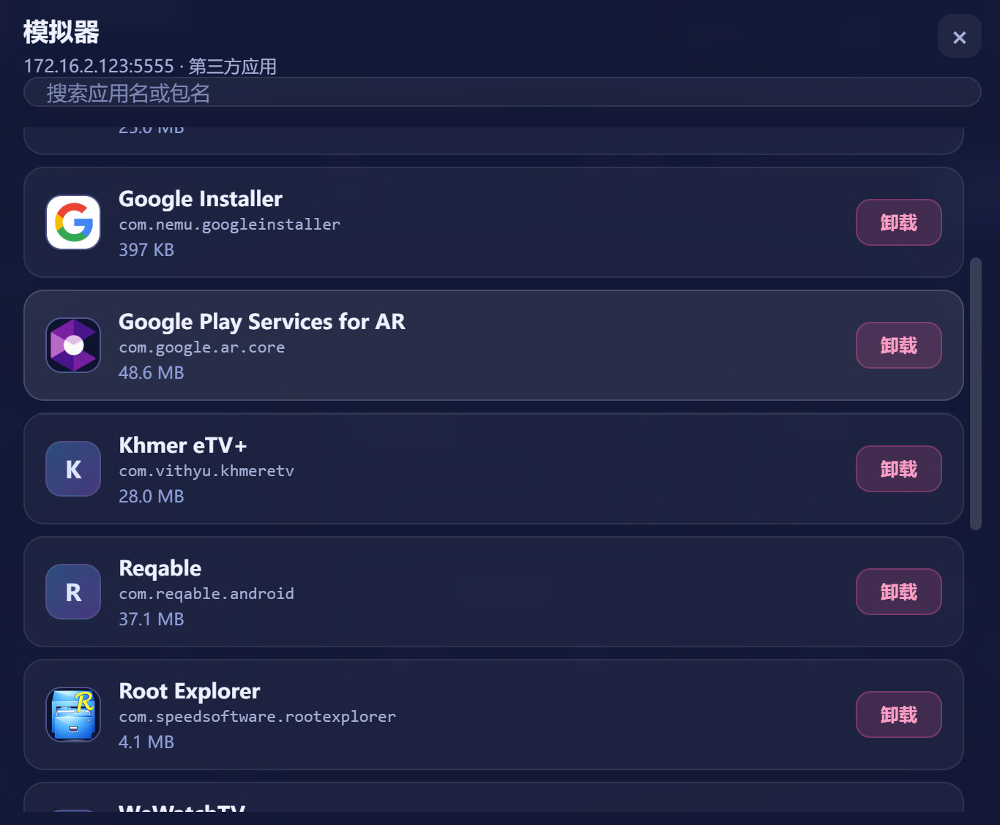

<div align="center">

# 📱 Scrcpy Android Console

**A LAN-based visual management platform for Android devices — mirror & control every set-top box, emulator, phone and tablet from one browser tab.**

**English** | [简体中文](README.zh-CN.md)

[](https://github.com/Juzer7113/Scrcpy-Android-Console)
[](https://github.com/Juzer7113/Scrcpy-Android-Console)
[](LICENSE)
[](releases/Scrcpy-Android-Console-v1.0.1.zip)

</div>

---

## ✨ Why this project

Managing a rack of Android devices usually means opening a dozen `adb` terminals, remembering
dozens of `adb connect IP:5555` commands, and fighting with scrcpy's dozens of flags —
one device at a time.

**Scrcpy Android Console** wraps [scrcpy](https://github.com/Genymobile/scrcpy) and `adb` in a
self-contained web console: add a device by IP, click **Connect & Control**, and the live screen
pops up in a window with full mouse/keyboard control. No Python, no Node, no Android SDK —
**Windows PowerShell is the only runtime**, and it's already on your machine.

Perfect for:

- 🖥️ **Set-top box / TV box fleets** — hotel IPTV boxes, OTT boxes, testing benches
- 📺 **Emulator farms** — MuMu, BlueStacks, LDPlayer, AVD side by side
- 🏪 **Device labs & shops** — demo units, kiosks, retail displays
- 🔧 **Anyone tired of typing `adb connect` for the 100th time**

## 📸 Screenshots

| Console dashboard | Live mirroring & control | One-click app uninstall |
|:---:|:---:|:---:|
|  |  |  |

## 🚀 Quick start

1. Download the portable package (16 MB):
   **[`Scrcpy-Android-Console-v1.0.1.zip`](https://github.com/Juzer7113/Scrcpy-Android-Console/releases/download/v1.0.1/Scrcpy-Android-Console-v1.0.1.zip)**
   — a copy also lives in the repo at
   [`releases/Scrcpy-Android-Console-v1.0.1.zip`](releases/Scrcpy-Android-Console-v1.0.1.zip)
2. Unzip anywhere. **No installation, no configuration.**
3. Double-click **`启动控制台.bat`** (`Android Console.bat`)
4. Your browser opens **<http://127.0.0.1:8000>** — that's it, the console is running.

> The black window *is* the service — close it to stop. Page won't open?
> Manually visit `http://127.0.0.1:8000` (port never changes).

## 📖 Usage

### 1. Add a device

Fill in **Device IP** (port defaults to `5555`) and an optional nickname
(e.g. `Lobby / Room 305`) → click **Add Device** → a device card appears.

- 🟢 green dot = online, ⚪ grey dot = offline (auto-probed every 30s, or hit **Refresh Status**)
- **Android 11+**: pair once first via *Developer options → Wireless debugging*: `adb pair IP:PAIR_PORT`
- **Android ≤ 10**: port 5555 is usually open by default — just add it

### 2. Connect & control

Click **Connect & Control** on a card → a live window pops up.

| Input | Action |
|---|---|
| Mouse click | Touch |
| Arrow keys | D-pad (perfect for TV boxes) |
| Enter | OK/Confirm |
| **Right mouse button** | Back |

### 3. Install APK

Click **Install APK** on a card → pick a `.apk` from your PC → it is uploaded and installed
automatically (over-install, data preserved).

### 4. Uninstall apps

Click **Uninstall** → a dialog lists all third-party apps on that device with
**icon, name, package name and size**, searchable. Click **Uninstall** → confirm → done.

> First open per device takes a few seconds (APKs are pulled to parse icons);
> after that it's cached and instant. Cache lives in `scrcpy\cache\apps\` — delete anytime.

### 5. Direct connect (no web UI)

Double-click `scrcpy\connect.bat` → type an IP → the window pops up immediately.
Handy for quick one-off debugging without starting the web service.

## 🏗️ Architecture

```
Browser (index.html)
    │  HTTP — 127.0.0.1 loopback only, never exposed to the LAN
    ▼
server.ps1  (PowerShell 5.1 + .NET HttpListener, port 8000)
    │  invokes the bundled executables
    ├── adb.exe          device discovery, connect, install, uninstall, pull
    ├── scrcpy.exe       screen mirroring + mouse/keyboard control
    └── tools\aapt2.exe  parses app names & icons from APKs
```

**Why a local backend?** Browser security policy forbids a web page from launching
executables on your machine — a local service must broker it. That's why this isn't a
pure-HTML page.

**Why PowerShell instead of Python/Node?** The target machine needs *zero* installs.
PowerShell 5.1 ships with Windows — no Python, no Node, no Android SDK, no VC++ redistributables.

## 🧰 Engineering highlights

- **Zero-dependency & fully portable** — copy the folder to a new PC and double-click. Audited:
  no hardcoded absolute paths (`%~dp0` / `$MyInvocation` self-locating), all DLLs bundled,
  loopback-only binding (no firewall prompts), pure-ASCII scripts (no encoding surprises).
- **Per-model encoder tuning** — reads `ro.product.model` at launch. The SW-618 box gets a
  dedicated hard-encoder + all-I-frame profile (works around a firmware encoder bug that makes
  FFmpeg spit `QP out of range`); everything else gets conservative defaults (1024px / 30fps / 4Mbps).
- **Real app icons** — pulls each APK, parses the label with aapt2, extracts the icon from the
  zip (PNG/WebP/JPG); vector-XML icons fall back to a letter avatar.
- **Smart icon cache** — `cache\apps\<pkg>\meta.json` records the APK path; when an app updates
  and the path changes, the cache invalidates itself.
- **Unicode-safe** — process output is force-decoded as UTF-8, so Khmer, Chinese and other
  non-ASCII app names never turn into mojibake.

## ⚠️ Known limitations

1. **Audio forwarding requires Android 11+** on the device (scrcpy server-side limit) —
   video and control are unaffected.
2. Some boxes emit non-spec H.264 streams (symptoms: FFmpeg `QP out of range` /
   `reference frames` errors). SW-618 is handled; other models can be added in the
   `Video-Args-For` function.
3. Apps with vector icons show a letter avatar.
4. The first uninstall-list open pulls every APK — expect ~10s on app-heavy devices, cached afterwards.
5. Each mirrored window = one H.264 decode. Keep it under ~8 concurrent windows; batch the
   rest with plain ADB commands.

## 📄 License

The console wrapper (`server.ps1`, `index.html`, launcher scripts) is released under the
**Apache-2.0** license. This project bundles [scrcpy](https://github.com/Genymobile/scrcpy)
© Genymobile, also Apache-2.0 — see [`scrcpy/LICENSE.txt`](scrcpy/LICENSE.txt).

## ⭐ Like it?

Give it a star — it helps other people fighting their own `adb connect` battles find this.
